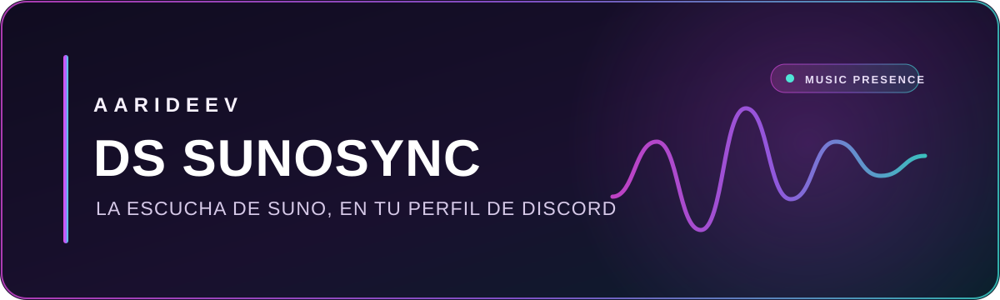

<p align="center">
  
</p>

<p align="center">
  
</p>

<p align="center">
  <a href="https://github.com/aariidev/DSsunoSync/releases/latest">
    
  </a>
  
  
  
</p>

<p align="center">
  <a href="https://github.com/aariidev/DSsunoSync/releases/latest"><strong>⬇ Descargar SunoSync</strong></a>
  &nbsp; · &nbsp;
  <a href="https://github.com/aariidev/DSsunoSync"><strong>Explorar el proyecto</strong></a>
</p>

---

<h2 align="center">La presencia de Suno que Discord aún no ofrece.</h2>

<p align="center">
  SunoSync conecta lo que escuchas en <strong>Suno</strong> con tu perfil de <strong>Discord</strong>.<br>
  Canción, artista, portada y un enlace directo: tu música también tiene lugar en tu actividad.
</p>

<br>

## ✦ Tu escucha, convertida en presencia

| 🎵 **Ahora suena** | 🎨 **Con identidad** | ↗ **A un clic** |
|:--:|:--:|:--:|
| El título y el artista de la canción aparecen en tu actividad. | La portada acompaña la escucha; el álbum aparece cuando corresponde. | El botón **Escuchar en Suno** lleva directamente a la canción. |

<p align="center">
  <strong>Reproduce en Suno</strong> &nbsp; ⟶ &nbsp;
  <strong>SunoSync detecta la escucha</strong> &nbsp; ⟶ &nbsp;
  <strong>Discord la muestra en tu perfil</strong>
</p>

| ⚡ **Se mantiene al día** | 🫧 **Discreto** | 🌐 **A tu manera** |
|:--:|:--:|:--:|
| Se actualiza al cambiar de canción y sigue el estado de reproducción. | Se integra con Discord Desktop y puede permanecer en la bandeja del sistema. | Extensión para Brave, Chrome y Edge. |

---

## ◈ Una idea que merece llegar a Discord

Discord permite compartir lo que estás haciendo. **SunoSync lleva esa idea a la música que nace y se escucha en Suno**: una presencia que da contexto a la canción y facilita descubrirla.

Es un proyecto independiente y una muestra de cómo podría sentirse una integración nativa de Suno en Discord.

<p align="center">
  <a href="https://github.com/aariidev/DSsunoSync/releases/latest"><strong>Prueba SunoSync</strong></a>
  &nbsp; · &nbsp;
  <a href="https://github.com/aariidev/DSsunoSync"><strong>Comparte la propuesta</strong></a>
</p>

<p align="center">
  <sub>No afiliado oficialmente con Discord ni con Suno.</sub>
</p>

---

## ⚙ Detalles técnicos

### Compatibilidad

| Componente | Requisito |
|:--|:--|
| Sistema | Windows 10 u 11 (x64) |
| Discord | Aplicación de escritorio abierta |
| Navegador | Brave, Chrome o Edge con extensiones Manifest V3 |
| Configuración de Discord | Application ID de una aplicación creada en el [Discord Developer Portal](https://discord.com/developers/applications); no se necesita bot ni bot token |

### Instalación

1. Descarga y ejecuta el instalador desde [GitHub Releases](https://github.com/aariidev/DSsunoSync/releases/latest).
2. Crea una aplicación en el [Discord Developer Portal](https://discord.com/developers/applications), copia su **Application ID** y configúralo en SunoSync.
3. En `brave://extensions`, `chrome://extensions` o `edge://extensions`, activa **Modo de desarrollador** y carga la carpeta de extensión indicada por SunoSync.
4. Abre el popup de la extensión, pulsa **Conectar con SunoSync** y permite el acceso a la red local si el navegador lo solicita.
5. Recarga Suno y reproduce una canción.

La extensión comprueba tanto el puente local como su conexión desde el service worker. Si algo falla, el popup muestra el estado del permiso y el detalle del error.

### Arquitectura y privacidad

```text
Suno (pestaña del navegador)
        ↓
Extensión Manifest V3
        ↓ HTTP local · 127.0.0.1:47831
SunoSync para Windows
        ↓ Discord IPC local
Discord Desktop
```

El puente local escucha únicamente en loopback. La extensión solicita acceso a Suno y al puente local; la conexión con Discord se realiza mediante su IPC local.

### Actualizaciones

SunoSync comprueba GitHub Releases y verifica la descarga del instalador con SHA-256. La aplicación se actualiza al instalar una nueva versión. Como la extensión se carga localmente, puede ser necesario pulsar **Recargar** en la página de extensiones después de actualizar.

### Compilación desde el código

Requiere Windows x64 y [.NET 10 SDK](https://dotnet.microsoft.com/download/dotnet/10.0). Para generar el instalador también se necesita [Inno Setup 6](https://jrsoftware.org/isinfo.php).

```powershell
.\Scripts\Build-Windows.ps1
```

Para compilar la aplicación sin generar el instalador:

```powershell
.\Scripts\Build-Windows.ps1 -SkipInstaller
```

El ejecutable se genera en `publish\ArideevSunoPresence.exe`; el instalador, en `dist\`.

### Límites conocidos

- Cambios en el reproductor o en Media Session de Suno pueden afectar la detección.
- La extensión instalada como descomprimida no se recarga automáticamente tras una actualización.
- Discord solo puede mostrar portadas externas accesibles mediante HTTPS.

---

<p align="center">
  <sub>AARIDEEV&nbsp; | &nbsp;DS SUNOSYNC</sub><br>
  <sub>Una escucha. Una presencia. Un mundo por descubrir.</sub>
</p>
